<div align="center">


<br/>

<a href="https://swe-rabia-aziz.vercel.app/"></a>
<a href="https://github.com/swe-rabiaaziz?tab=repositories"></a>
<a href="https://www.linkedin.com/in/swe-rabiaaziz/"></a>
<a href="https://wa.me/923275676026"></a>
<a href="https://www.tiktok.com/@swe.rabiaaziz"></a>
<a href="mailto:swe.rabiaaziz@gmail.com"></a>
<a href="https://calendly.com/swe-rabiaaziz/30min"></a>
<a href="https://drive.google.com/file/d/1-QpVie8mLQpp-96RLKbq697vNbhfo_G1/view?usp=drive_link"></a>

</div>

<br/>


## 01 · What I Build & Deliver

> **"Code is craft. Every pixel, every animation, every state transition — I obsess over the details so users don't have to."**  
> I engineer AI-powered experiences, scalable Flutter applications, and rock-solid cloud backends that run fluidly across mobile, web, and desktop. From idea and Figma wireframes to store release, I own the entire pipeline.

<br/>


<br/>


<br/>


<br/>


## 02 · Shipped to Stores (Google Play Live)

Four production applications authored, engineered, and published live on the **Google Play Store**.

<br/>

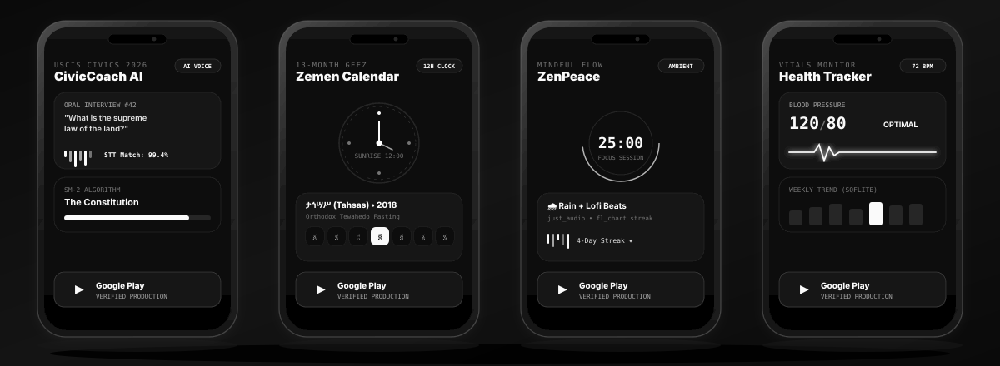

<br/>

<table width="100%" border="0" cellspacing="8" cellpadding="0">
<tr>
<td width="50%" align="left" valign="top">

<a href="https://play.google.com/store/apps/details?id=com.us.citizenship.test.naturalization.civics.prep&hl=en">
  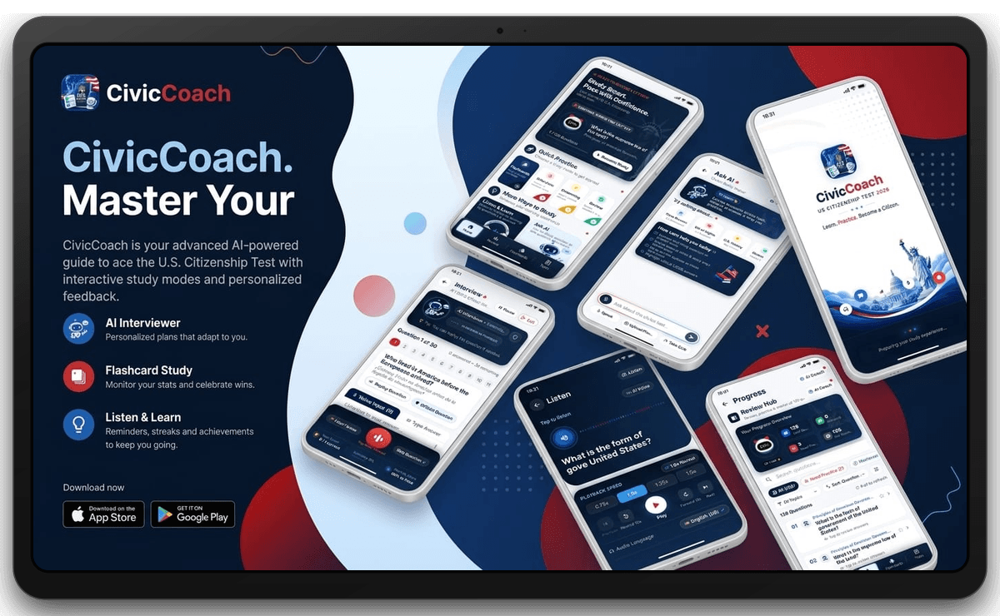
</a>

### 🏛️ 01 · CivicCoach — AI US Citizenship
*AI Voice Interviews · Spaced Repetition · Official 128 Questions*

• **AI Voice Mock Interviews:** Speech-to-Text &amp; automated oral scoring.  
• **SM-2 Algorithm:** Spaced-repetition flashcards tailored to retention curves.  
• **Dynamic Officials Lookup:** Live ZIP query for US Senators &amp; Governors.  
• **Bilingual &amp; Audio:** Full English &amp; Spanish with synchronized narration.  

**Stack:** `Flutter` · `Dart` · `Drift ORM` · `SQLite` · `STT/TTS` · `Provider`

<br/>

<a href="https://play.google.com/store/apps/details?id=com.us.citizenship.test.naturalization.civics.prep&hl=en"></a>

</td>
<td width="50%" align="left" valign="top">

<a href="https://play.google.com/store/apps/details?id=com.ethiopia.zemen.calendar.aqotater.ethiopian.habesha&hl=en">
  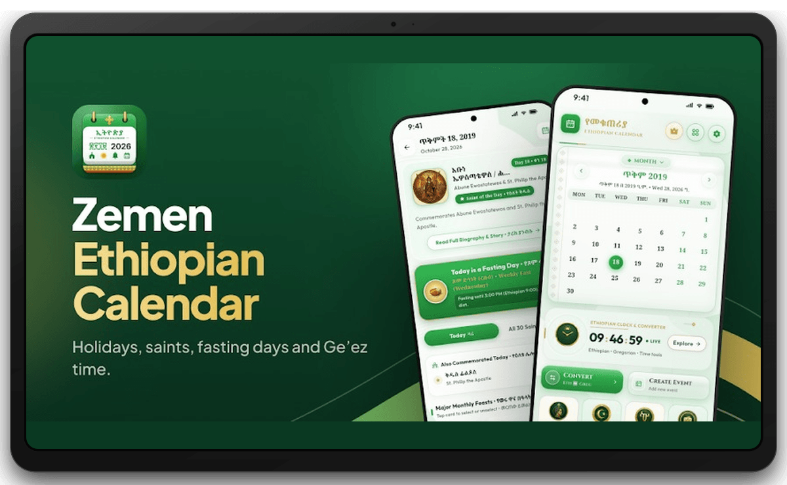
</a>

### 📅 02 · Ethiopian Calendar — Zemen App
*13-Month Ge'ez Navigation · 12H Sunrise Clock · Cultural Hub*

• **13-Month Ge'ez Navigation:** Full year with 12 months of 30 days + Pagume.  
• **12-Hour Sunrise Clock:** Interactive widget tracking traditional daytime cycles.  
• **Orthodox &amp; Islamic Sync:** Fasting periods, saints days &amp; prayer timetables.  
• **Holiday Reminders:** Dynamic national holiday countdowns &amp; local events.  

**Stack:** `Flutter` · `Dart` · `Calendar Engine` · `Local Persistence` · `Provider`

<br/>

<a href="https://play.google.com/store/apps/details?id=com.ethiopia.zemen.calendar.aqotater.ethiopian.habesha&hl=en"></a>

</td>
</tr>
<tr>
<td width="50%" align="left" valign="top">

<br/>

<a href="https://play.google.com/store/apps/details?id=com.zenpeace.pomodoro.focus.timer.mindfulstate&hl=en">
  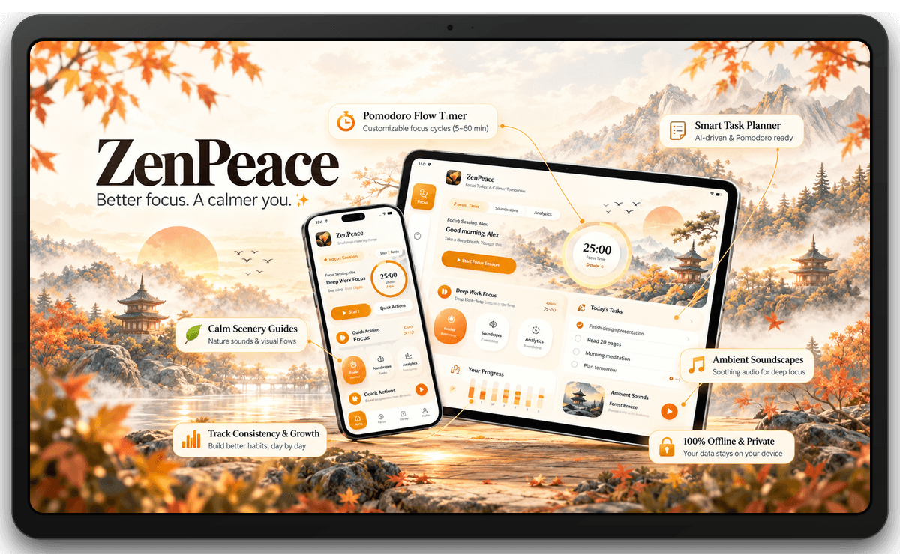
</a>

### 🧘 03 · ZenPeace — Pomodoro &amp; Mindful Flow
*Ambient Soundscapes · Focus Intervals · fl_chart Analytics*

• **Customizable Rituals:** Focus intervals, short breaks &amp; restoration cycles.  
• **Curated Soundscapes:** Looped ambient audio (rain, waves, lofi) via `just_audio`.  
• **Productivity Analytics:** Daily streaks &amp; completion frequency via `fl_chart`.  
• **Tactile Touch:** Haptic feedback triggers on thresholds with zero UI clutter.  

**Stack:** `Flutter` · `Dart` · `Provider` · `just_audio` · `fl_chart` · `Caching`

<br/>

<a href="https://play.google.com/store/apps/details?id=com.zenpeace.pomodoro.focus.timer.mindfulstate&hl=en"></a>

</td>
<td width="50%" align="left" valign="top">

<br/>

<a href="https://play.google.com/store/apps/details?id=com.vitals.bp.family.health.tracker&hl=en">
  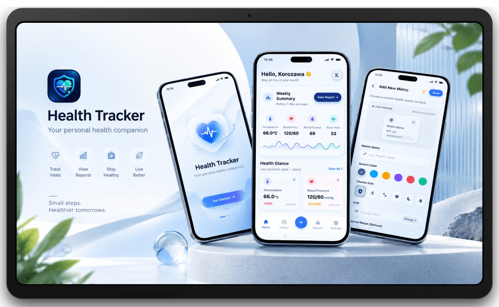
</a>

### 💓 04 · Health Tracker — Vitals &amp; BP Monitor
*Blood Pressure · Pulse Rate · On-Device SQLite · Clinical Reports*

• **Comprehensive Telemetry:** Blood Pressure, Pulse, Glucose &amp; Body Temp.  
• **Cardiovascular Trends:** Interactive visual graphs with health summaries.  
• **100% Private &amp; Offline:** Zero cloud sync; secured in local SQLite.  
• **Clinical Export:** Historical health telemetry exportable for medical consult.  

**Stack:** `Flutter` · `Dart` · `SQFlite` · `Provider` · `Data Vis` · `Clean Arch`

<br/>

<a href="https://play.google.com/store/apps/details?id=com.vitals.bp.family.health.tracker&hl=en"></a>

</td>
</tr>
</table>

<br/>


## 03 · Engineering Craft & Architecture

Great software isn't just about how it looks on day one. It's about how it performs on a mid-range phone under heavy load six months and forty features later.

<br/>


<br/>

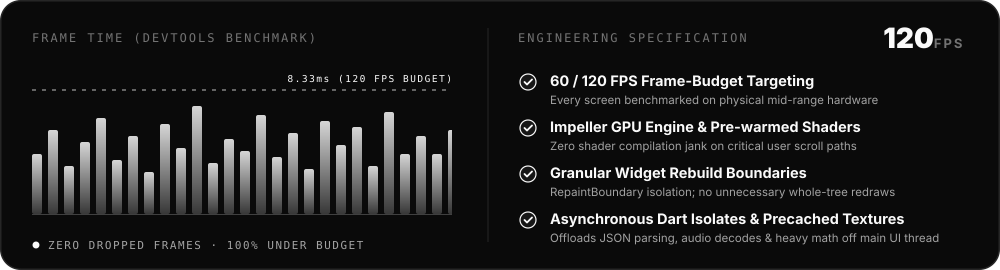

<br/>


<br/>

<details>
<summary><b>⚡ The 120 FPS Standard — Profiling Every Microsecond</b></summary>
<br/>

Every production application is benchmarked against strict frame budget targets:

- **Impeller GPU Pipeline**: Pre-compiled shaders eliminate shader compilation jank (*jank-free first scrolls*).
- **Subtree Repaint Isolation**: Heavy animated widgets wrapped in `RepaintBoundary` nodes prevent whole-screen layer redraws.
- **Texture Pre-warming**: Raster assets and SVG vectors decoded asynchronously off-screen before scroll entry.
- **Dart Isolates**: CPU-intensive JSON serialization and audio spectrum transforms offloaded to background threads.

</details>

<details>
<summary><b>🏛️ Feature-First Clean Architecture Directory Layout</b></summary>
<br/>

A modular, feature-first structure with an explicit dependency rule: `presentation → domain ← data`.

```text
lib/
├── app/                  # Application configuration, routing & dependency injection
│   ├── di/               # get_it / injectable service locators
│   ├── routes/           # GoRouter declarative navigation with deep linking
│   └── app_theme.dart    # Monochromatic high-contrast light/dark themes
├── core/                 # Shared domain-agnostic foundation
│   ├── constants/        # Layout metrics, typography scales, durations
│   ├── errors/           # Failure models, domain exceptions & crash reporters
│   ├── network/          # HTTP client, interceptors, connectivity monitors
│   └── utils/            # Haptic drivers, audio managers, string formatters
├── features/             # Feature-first self-contained modules
│   ├── civics_interview/ # Data (Drift), Domain (UseCases), Presentation (BLoC)
│   ├── zemen_calendar/   # Geez 13-month conversion engine & UI
│   ├── pomodoro_flow/    # Soundscape engine, timer streams, haptics
│   └── vitals_monitor/   # SQFlite reactive DB queries & report cards
├── shared/               # Reusable atomic widgets (tactile buttons, pills, cards)
└── main.dart             # Environment bootstrappers & error boundary wraps
```

Every feature is an independent module — delete any feature folder and the rest of the application builds without compilation cascades.

</details>

<details>
<summary><b>🔄 State Management Decision Matrix: BLoC vs Provider</b></summary>
<br/>

| Pattern | Best Suited For | Rationale |
| :-- | :-- | :-- |
| **BLoC / Cubit** | Event-driven flows: authentication, audio mock interviews, streamed LLM responses, multi-step checkout | Explicit, immutable events and states ensure complete predictability, testability, and audit trails. |
| **Provider** | Scoped UI reactivity: timers, theme toggles, simple form state, audio play/pause controls | Zero boilerplate, minimal overhead, and surgical widget rebuilding close to the presentation layer. |

</details>

<details>
<summary><b>💾 Offline-First Architecture Principle</b></summary>
<br/>

The local database is the single source of truth. The user interface never halts on network roundtrips.

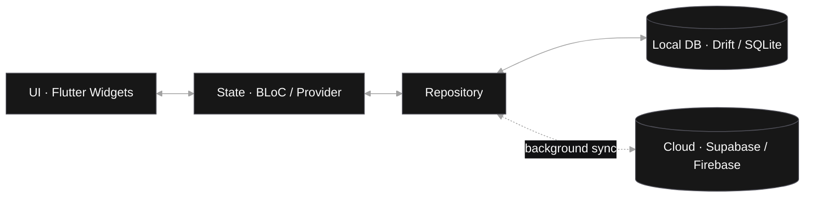

</details>

<br/>


## 04 · Technical Arsenal & Stack


<br/>

<table>
<tr>
<td width="220"><b>Mobile & Frameworks</b></td>
<td>


</td>
</tr>
<tr>
<td><b>State Management</b></td>
<td>


</td>
</tr>
<tr>
<td><b>Cloud & Databases</b></td>
<td>


</td>
</tr>
<tr>
<td><b>AI & Machine Learning</b></td>
<td>


</td>
</tr>
<tr>
<td><b>Engineering Tooling</b></td>
<td>


</td>
</tr>
</table>

<br/>


## 05 · What Mentors & Team Leads Say

<br/>


<br/>


## 06 · Professional Journey & Credentials

| Milestone | Organization / Institution | Scope & Responsibilities | Timeline |
| :-- | :-- | :-- | :-- |
| 💼 **Active Industry Role** | **Junior Flutter Developer** @ X Dev Soft | Production mobile UI, REST APIs, clean modular architectures, app performance profiling, and feature delivery | `2025 — Present` |
| 🎓 **Degree Program** | **BS in Software Engineering (BSSE)** — Virtual University of Pakistan | Software architecture, algorithms, OOP, scalable distributed systems | `Ongoing` |
| 🏆 **Professional Training** | **Flutter App Development** — Arfa Karim Tech Incubator, Peshawar | Full-stack cross-platform engineering, BLoC/Cubit, Firebase &amp; Drift persistence, clean architecture | `Completed Sept 2025` |
| 📜 **Professional Certification** | **Digital Skills &amp; Freelancing** — KP-TEVTA &amp; Helvetas Pakistan | International remote client delivery, workflow automation, technical scoping | `Certified` |
| 📜 **Vocational Qualification** | **NCVQ IT Computer Operator** — KP Trade Testing Board | System fundamentals, modular software execution | `Certified` |

<br/>


## 07 · GitHub Activity & Contribution Stream

<div align="center">


<br/><br/>


</div>

<br/>


## 08 · Let's Connect & Collaborate

<a href="https://wa.me/923275676026">
  
</a>

<div align="center">

<br/>

<a href="https://wa.me/923275676026"></a>
&nbsp;
<a href="https://calendly.com/swe-rabiaaziz/30min"></a>
&nbsp;
<a href="mailto:swe.rabiaaziz@gmail.com"></a>
&nbsp;
<a href="https://swe-rabia-aziz.vercel.app/"></a>

<br/><br/>

```text
╔══════════════════════════════════════════════════════════════════════════════╗
║                                                                              ║
║   "I don't just write Flutter code — I engineer fluid mobile experiences."   ║
║   Available worldwide for full-time remote roles & mobile contract builds.   ║
║                                                                              ║
║                                        — Rabia Aziz (@swe-rabiaaziz)         ║
╚══════════════════════════════════════════════════════════════════════════════╝
```


</div>
